# Rede corporativa no Cisco Packet Tracer

Montei essa rede no Packet Tracer pra praticar o que aparece o tempo todo no suporte e na infraestrutura: VLANs, roteamento entre elas, DHCP, DNS, NAT e uma regra de segurança. A empresa é a mesma "Ricarte LTDA" do meu [lab de Active Directory](https://github.com/guricartee/lab-active-directory-windows-server-2022), só que agora vista pelo lado da rede.

**Tecnologias:** VLAN · Trunk 802.1Q · Router-on-a-stick · DHCP · DNS · HTTP · NAT (PAT) · ACL

O arquivo do projeto (`rede-ricarte.pkt`) está aqui no repositório, então dá pra abrir no Packet Tracer e mexer à vontade.

## Como a rede é

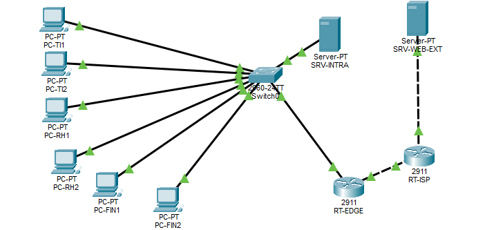

```
[SRV-WEB-EXT]──[RT-ISP]──[RT-EDGE]──[SW1]──┬─ PC-TI1, PC-TI2      (VLAN 10)
 203.0.113.10                              ├─ PC-RH1, PC-RH2      (VLAN 20)
                                           ├─ PC-FIN1, PC-FIN2    (VLAN 30)
                                           └─ SRV-INTRA           (VLAN 40)
```

O `RT-EDGE` é o roteador da empresa. O `RT-ISP` e o `SRV-WEB-EXT` fazem o papel da "internet", pra eu conseguir testar o NAT de verdade.

### VLANs e endereçamento

| VLAN | Nome | Rede | Gateway (RT-EDGE) | IP dos equipamentos |
|---|---|---|---|---|
| 10 | TI | 192.168.10.0/24 | 192.168.10.1 | DHCP |
| 20 | RH | 192.168.20.0/24 | 192.168.20.1 | DHCP |
| 30 | FINANCEIRO | 192.168.30.0/24 | 192.168.30.1 | DHCP |
| 40 | SERVIDORES | 192.168.40.0/24 | 192.168.40.1 | Fixo (`SRV-INTRA` = 192.168.40.10) |

O terceiro número do IP é o ID da VLAN, então dá pra saber de que departamento é um equipamento só de olhar o endereço.

### Link com a "internet"

| Ponto | IP |
|---|---|
| RT-EDGE Gi0/1 | 198.51.100.2/30 |
| RT-ISP Gi0/0 | 198.51.100.1/30 |
| RT-ISP Gi0/1 | 203.0.113.1/24 |
| SRV-WEB-EXT | 203.0.113.10/24 |

Usei as faixas 198.51.100.0/24 e 203.0.113.0/24, que são reservadas pra documentação (RFC 5737), então não conflitam com nenhuma rede real.

## O que configurei

- **Switch (SW1):** criei as 4 VLANs, coloquei cada porta na VLAN certa e deixei a porta que sobe pro roteador em trunk, liberando só as VLANs 10, 20, 30 e 40.
- **Roteamento entre VLANs (router-on-a-stick):** uma única porta do `RT-EDGE` com uma subinterface por VLAN, cada uma funcionando como o gateway da sua rede.
- **DHCP:** um pool por VLAN no próprio roteador, já entregando gateway, DNS e domínio. Reservei os primeiros endereços de cada rede pra equipamentos fixos.
- **DNS e HTTP:** o `SRV-INTRA` resolve `intranet.ricarte.local` e hospeda uma página de intranet simples.
- **NAT (PAT):** as redes internas saem pra "internet" com o IP do `RT-EDGE`.
- **ACL:** uma regra que impede o RH de acessar a rede do Financeiro, sem atrapalhar o resto.

Os comandos de cada equipamento estão na pasta [`configs/`](configs).

## Testes e o que cada um provou

### VLANs e trunk

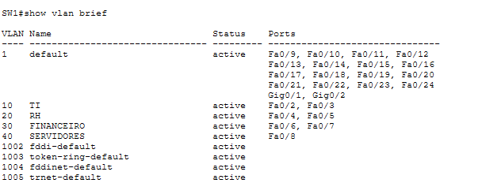

As 4 VLANs existem e cada porta está na VLAN certa.

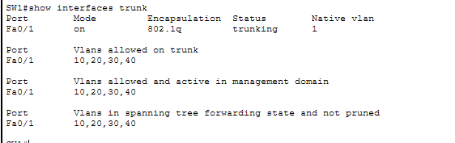

A porta `Fa0/1` está em trunk (802.1Q) e só libera as VLANs 10, 20, 30 e 40.

### Rotas

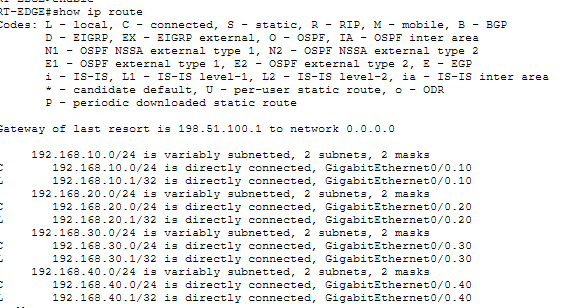

O roteador tem uma rota conectada pra cada VLAN, cada uma na sua subinterface (`Gi0/0.10`, `.20`, `.30` e `.40`), e conhece o caminho padrão pra "internet" (*gateway of last resort* `198.51.100.1`).

### DHCP

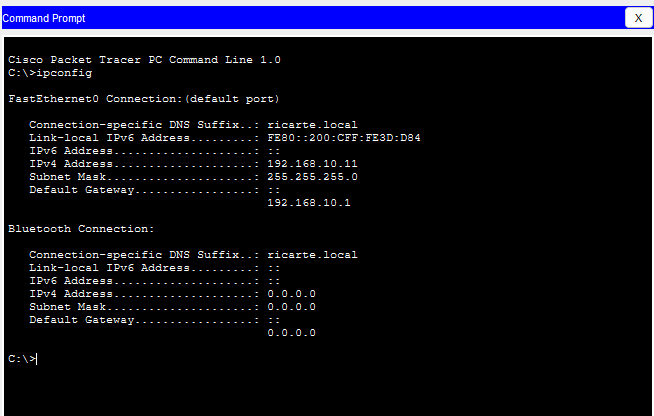

O PC pegou sozinho IP, máscara e gateway da VLAN 10, além do sufixo de domínio `ricarte.local`.

### Roteamento entre VLANs

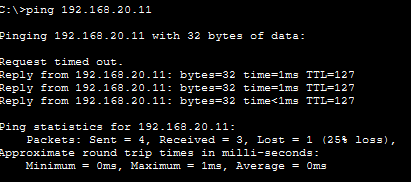

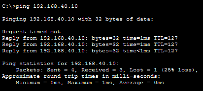

Um PC da TI consegue falar com a VLAN do RH e com o servidor da VLAN 40, então o router-on-a-stick está roteando. O primeiro pacote costuma se perder porque os equipamentos ainda estão aprendendo os endereços uns dos outros (ARP), e os seguintes respondem normalmente. O `TTL=127` mostra que o pacote passou por um roteador no caminho.

### Saída pra "internet" e NAT

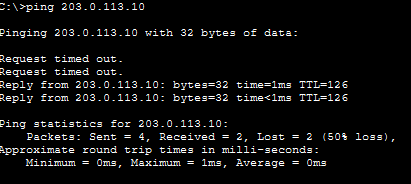

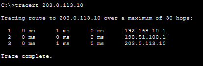

O PC alcança o `SRV-WEB-EXT`. O `tracert` mostra o caminho: gateway da VLAN (`192.168.10.1`), `RT-ISP` (`198.51.100.1`) e o servidor (`203.0.113.10`). O `TTL=126` bate com isso, já que o pacote passou por dois roteadores.

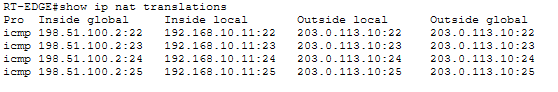

A tabela de NAT mostra o PC `192.168.10.11` (*inside local*) saindo com o IP `198.51.100.2` (*inside global*, o do roteador). O `RT-ISP` não tem rota pras redes 192.168.x.x, então só consegue conversar com a empresa por causa do NAT.

### DNS e intranet

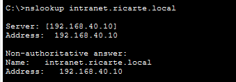

O nome `intranet.ricarte.local` resolve pro `192.168.40.10`, o DNS que o DHCP entregou pro PC.

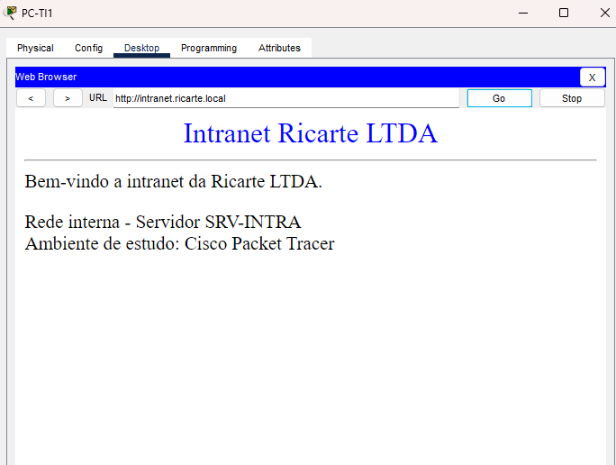

E a página da intranet abre pelo navegador do PC usando o nome.

### ACL (RH não acessa o Financeiro)

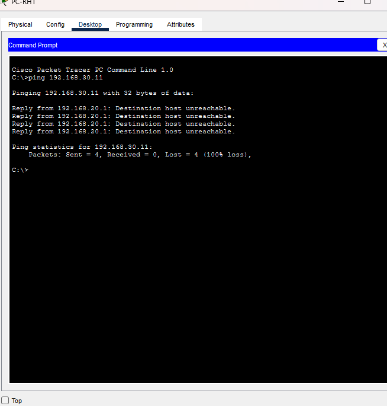

O ping do `PC-RH1` pra rede do Financeiro volta com *Destination host unreachable* vindo do gateway do RH (`192.168.20.1`). Ou seja, o pacote chegou no roteador e a ACL barrou.

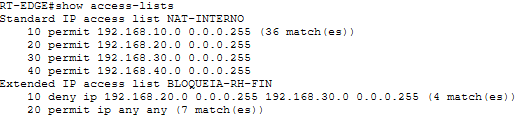

O `show access-lists` mostra as regras e quantos pacotes bateram em cada uma: a lista do NAT, a regra `deny` entre RH e Financeiro e o `permit ip any any` que libera o resto. Por isso o RH continua acessando a intranet e os outros departamentos continuam falando com o Financeiro.

## O que aprendi

- **O `show interfaces trunk` só mostra porta que está de fato em trunk.** No começo ele veio vazio e eu achei que tinha errado, mas era só o roteador ainda desligado do outro lado do cabo. Depois do `no shutdown` na porta dele, o trunk apareceu.
- **Router-on-a-stick** é uma forma barata de rotear entre VLANs: uma porta física, várias subinterfaces.
- **O NAT esconde a rede interna.** De fora, só se vê o IP do roteador, e a conversa só acontece se começar de dentro.
- **Uma ACL precisa ficar no lugar certo.** Aplicada na entrada da subinterface do RH, ela barra o tráfego perto da origem e não afeta as outras VLANs.
- **A resposta de um ping diz muito.** `Destination host unreachable` vindo do gateway é diferente de `Request timed out`, e o TTL ajuda a contar quantos roteadores o pacote atravessou.

## Como abrir

Baixa o `rede-ricarte.pkt` e abre no Cisco Packet Tracer. Os dispositivos já estão configurados, mas dá pra conferir ou refazer tudo com os arquivos da pasta `configs/`.

## Estrutura do repositório

```
rede-corporativa-packet-tracer/
├── README.md
├── rede-ricarte.pkt
├── configs/
│   ├── sw1.txt
│   ├── rt-edge.txt
│   └── rt-isp.txt
└── screenshots/
```

> A empresa "Ricarte LTDA", os nomes e os endereços são fictícios. É um ambiente de estudo, sem nenhum dado real.
